<div align="center">

# Reem Sharaf — Portfolio

**Eng. Reem Sharaf (ريم شرف)** · Software Engineer · AI Researcher & Developer · University Lecturer · Damascus, Syria

**Live:** [reemsharaf.vercel.app](https://reemsharaf.vercel.app)

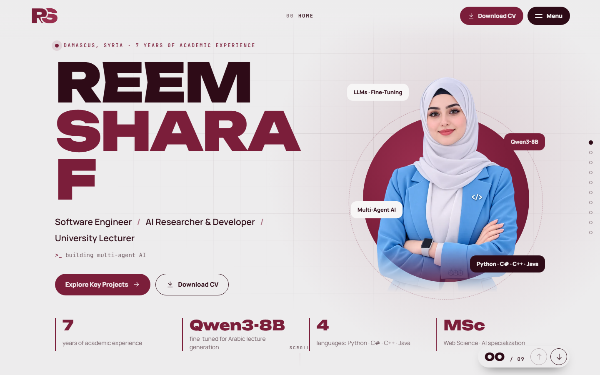

</div>

---

## نظرة سريعة (بالعربي)

موقع شخصي سينمائي للمهندسة **ريم شرف**، مبني بدون أي مكتبات خارجية (HTML و CSS و JavaScript فقط)، فهو خفيف جداً وسريع.

- **صفحة واحدة تفاعلية بلا تمرير للأسفل:** الأقسام تتبدّل **في نفس المكان**، فيبدو الموقع قطعة واحدة.
- **كل قسم يفتح بحركة مختلفة:** باب ينفتح من المنتصف، سقوط من الأعلى، عدسة دائرية، انفتاح من الزاوية، قلب صفحة مثل المجلة، شرائح، دفع جانبي، مصراع، تكبير، ونافذة تتفتح.
- **افتتاحية:** شعار RS يُرسم أمامك مع عدّاد تحميل، ثم تنفتح الستارة. تظهر مرة واحدة في كل زيارة.
- **كل قسم بتصميم مختلف:** فاتح، داكن، نبيذي، وردي، بخطوط وتخطيطات مختلفة، وبدون بطاقات مكررة.
- **المهارات:** أيقونة لكل مهارة (48 مهارة في 7 مجالات)، تطفو على الخلفية بدون إطارات أو خطوط.
- **الشهادات:** معرض أفقي بإطار موحّد لكل الوثائق. اضغط على أي شهادة لتكبيرها.
- **متجاوب بالكامل:** موبايل وتابلت وشاشات كبيرة. على الموبايل يتم التنقل بالسحب، وعلى الكمبيوتر بعجلة الماوس أو الأسهم أو الأزرار.
- **سرعة وسلاسة:** الحركات تعتمد على `transform` و `opacity` و `clip-path` فقط، فتعمل على كرت الشاشة بدون تقطيع، ولا يوجد أي canvas أو مؤثرات تعمل باستمرار.

### الأرشفة في Google ومحركات الذكاء الاصطناعي (SEO · AEO · GEO)
- الصفحة الرئيسية تجمع كل الأقسام، ولكل قسم أيضاً **صفحة مستقلة** (`/about`، `/skills` …) فيها عنوان ووصف و canonical خاص بها، وكلها مسجّلة في `sitemap.xml`.
- بيانات منظمة كاملة (JSON-LD): Person و ProfilePage و FAQPage و BreadcrumbList و Thesis و ItemList.
- ملفات `llms.txt` و `llms-full.txt` لمحركات الذكاء الاصطناعي، و `robots.txt` يسمح لـ GPTBot و ClaudeBot و PerplexityBot و Google-Extended وغيرها.
- صورة مشاركة للرابط (Open Graph 1200×630) وأيقونة للتبويب (favicon) و manifest.
- الاسم العربي «ريم شرف» موجود في طبقة SEO فقط (meta و JSON-LD و llms)، والموقع الظاهر إنجليزي.

### التشغيل محلياً
```bash
npm run dev
```
يبني الموقع في `dist/` ويفتحه على http://localhost:3000

### تعديل المحتوى
كل النصوص في ملف واحد: **`src/content.mjs`**، وهي مطابقة للسيرة الذاتية. عدّل الملف ثم شغّل `npm run build`، فتتحدث كل الصفحات وخريطة الموقع والبيانات المنظمة و llms.txt معاً.

### بعد النشر (مهم للظهور في Google)
1. افتح [Google Search Console](https://search.google.com/search-console) وأضف الموقع `https://reemsharaf.vercel.app` بطريقة **URL prefix**.
2. اختر التحقق بطريقة **HTML tag**، وضع قيمة `content` في `googleSiteVerification` داخل `src/content.mjs`، ثم أعد النشر.
3. من قسم **Sitemaps** أرسل الرابط: `https://reemsharaf.vercel.app/sitemap.xml`.
4. كرر نفس الخطوات في [Bing Webmaster Tools](https://www.bing.com/webmasters) (الحقل `bingSiteVerification`)، لأن ChatGPT و Copilot يعتمدان على Bing.
5. ضع رابط الموقع في LinkedIn ريم (Contact info و Featured).

---

## The experience

The home page is a **stage**: the page never scrolls. Wheel, swipe, arrow keys, the menu, the rail and the bottom-right arrows all swap sections **in place**. Long sections scroll inside their own layer, and at the edge the next gesture moves on. Each section declares its own transition:

| # | Section | Look | Opens with |
|---|---|---|---|
| 00 | Home | light, editorial hero | doors part from the centre |
| 01 | Summary | paper; the statement lights up word by word | drops from the top |
| 02 | Core Competencies | dark index with icons, no dividers | iris from the centre |
| 03 | Experience | vertical timeline that fills as you scroll | unfolds from the top-left corner |
| 04 | Key Projects | wine; pinned, projects travel sideways | turns like a magazine page |
| 05 | Technical Skills | dotted field, an icon for every skill | slats sweep across |
| 06 | Education | blush, giant degree letters | pushes in sideways |
| 07 | Certifications | dark gallery, one frame format for all documents | shutter opens from the centre line |
| 08 | FAQ | split layout, sticky question mark | zooms through |
| 09 | Contact | wine, giant type | a rounded window blooms to full screen |

<table>
<tr><td>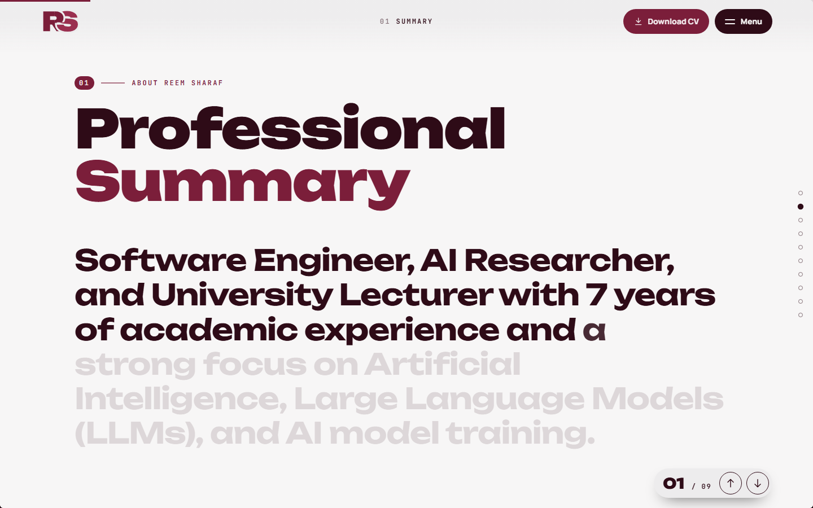</td><td>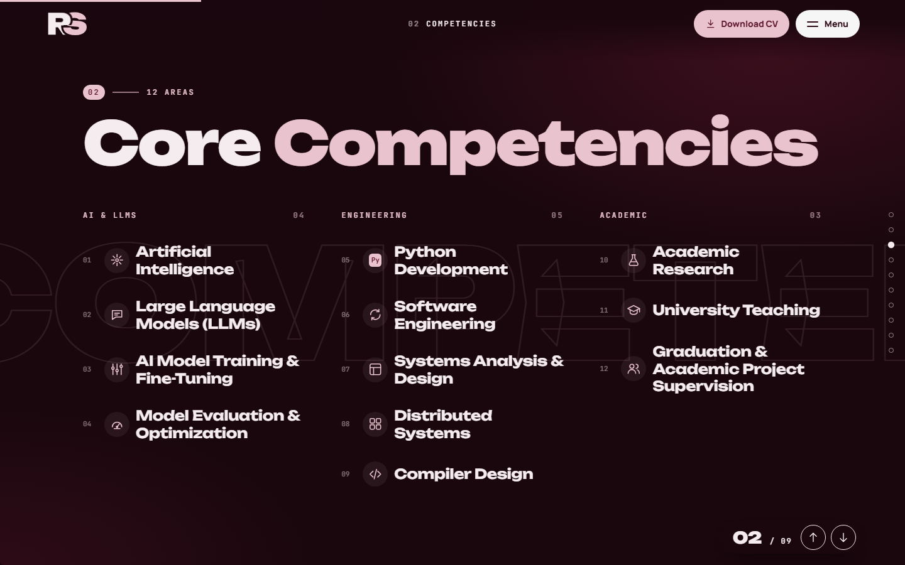</td></tr>
<tr><td>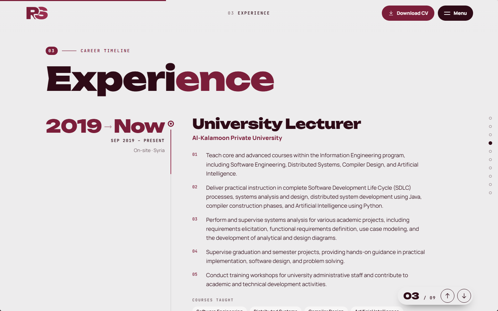</td><td>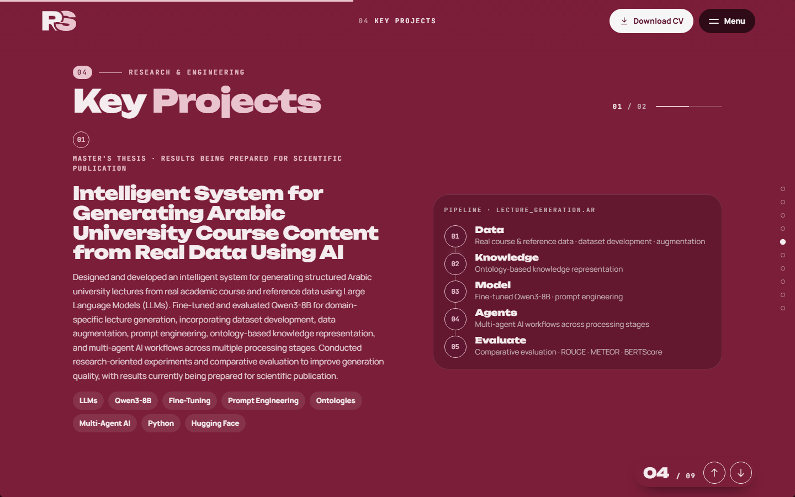</td></tr>
<tr><td>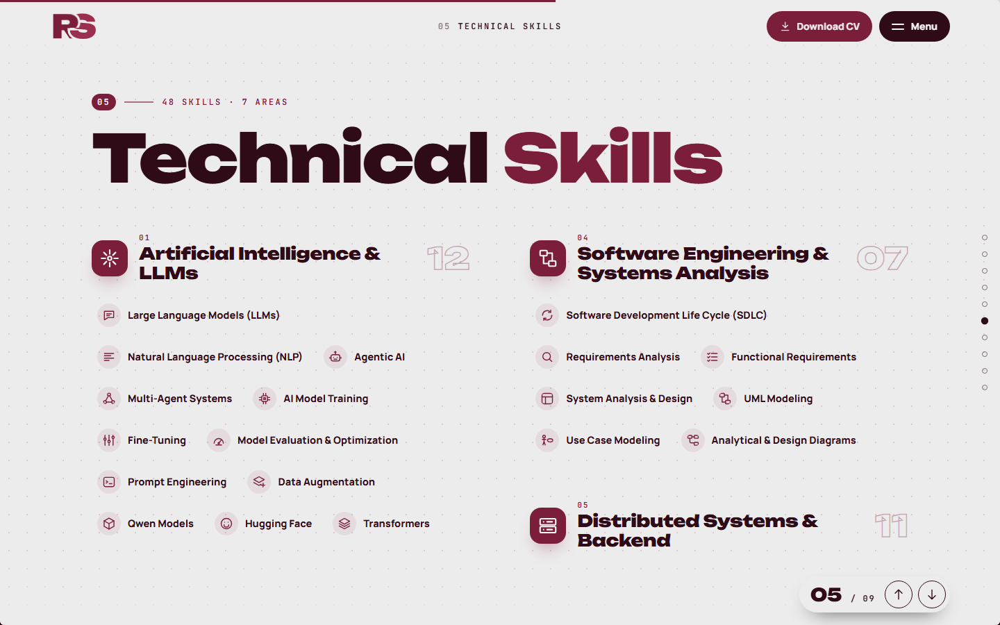</td><td>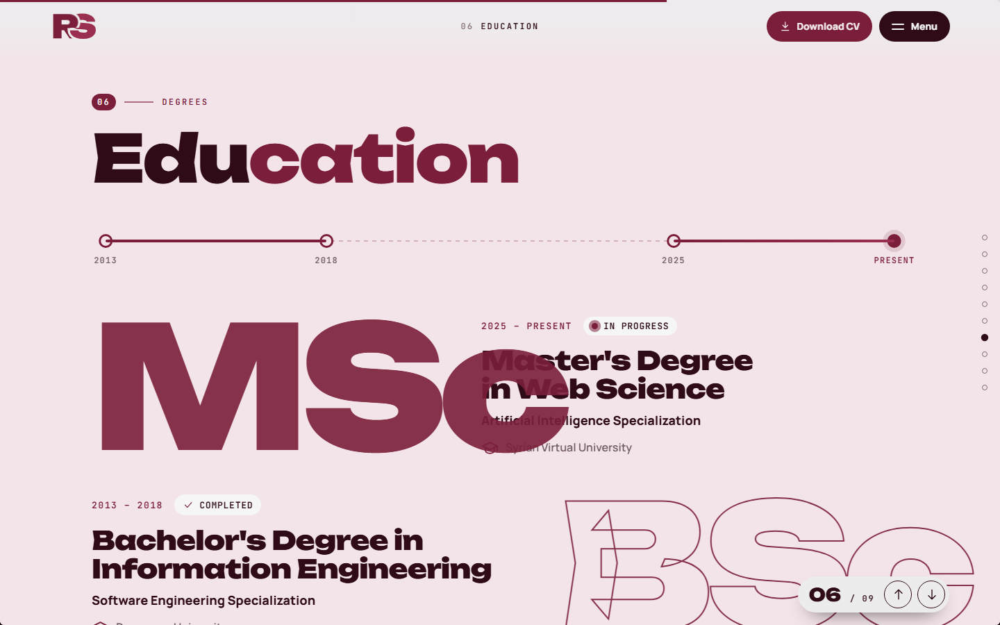</td></tr>
<tr><td>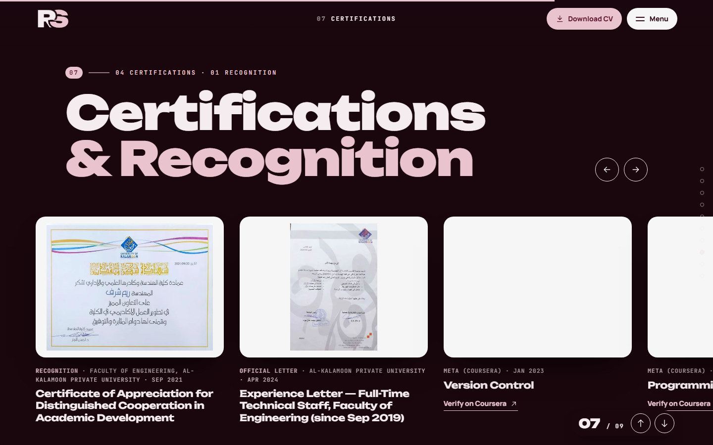</td><td>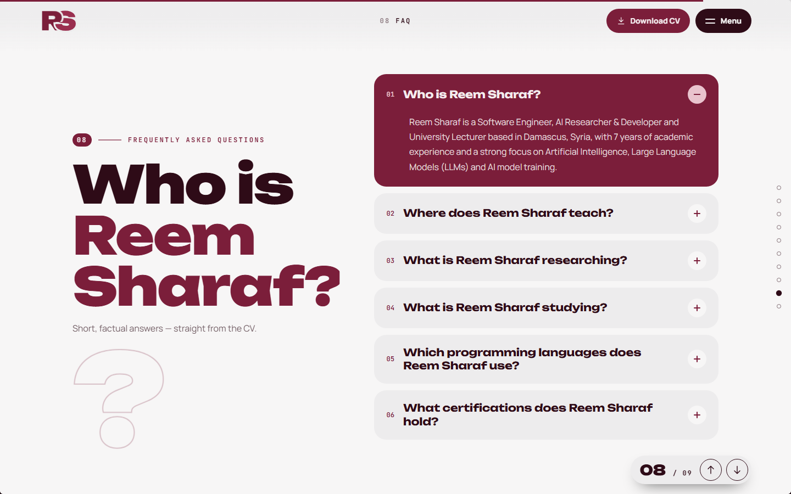</td></tr>
<tr><td>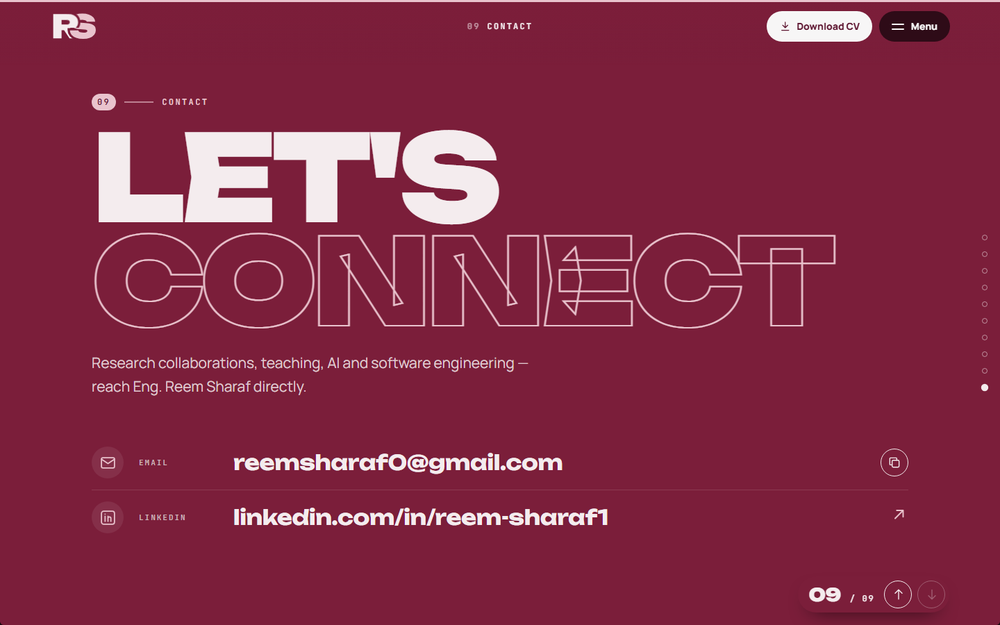</td><td>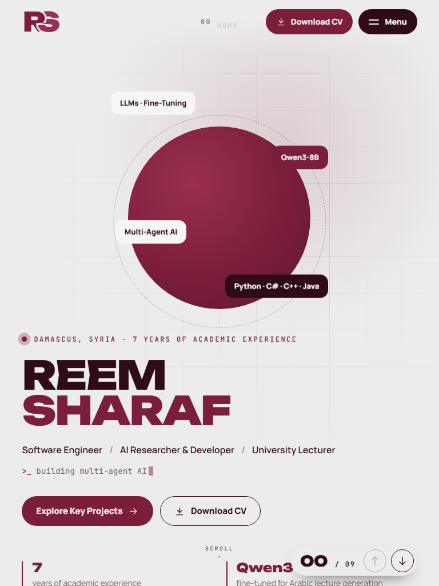 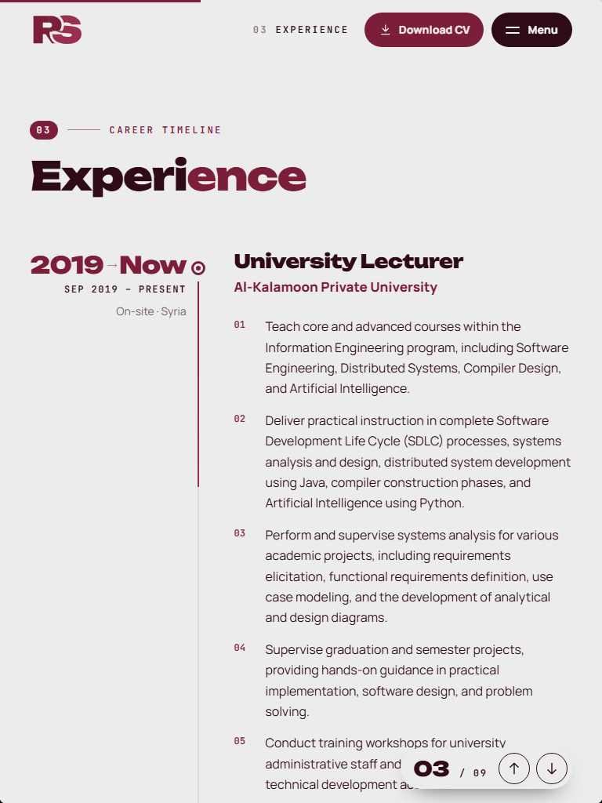</td></tr>
</table>

## Pages (all in `sitemap.xml`)

| URL | Content |
|---|---|
| `/` | The full one-page experience (every section) |
| `/about` | Professional summary · key strengths · languages |
| `/competencies` | 12 core competencies |
| `/experience` | University Lecturer (2019 – present) · Volunteer (2017 – 2019) |
| `/projects` | Master's thesis (Qwen3-8B, Arabic lectures) · microservices system |
| `/skills` | 48 skills in 7 areas |
| `/education` | MSc Web Science (AI) · B.Eng. Information Engineering |
| `/certifications` | Coursera (Meta) certificates · recognition · experience letter |
| `/faq` | "Who is Reem Sharaf?" — FAQPage structured data |
| `/contact` | Email · LinkedIn · phone · CV |

## Project structure

```
src/
  content.mjs            all text — mirrors the CV
  sections/<key>.mjs     one module per section (markup)
  sections/index.mjs     section registry
  styles/base|chrome|motion|stage.css
  styles/sections/<key>.css
  scripts/00-core.js     helpers + one shared scroll loop
  scripts/10-reveal.js   element reveals
  scripts/20-nav.js      menu, labels, standalone pages
  scripts/30-sections.js per-section behaviour
  scripts/40-stage.js    intro + in-place transitions
  layout.mjs · seo.mjs · icons.mjs · lib.mjs · templates.mjs
build.mjs                → dist/ (pages, sitemap, robots, llms, manifest, bundled CSS/JS)
```

**Add a section:** add an entry to `PAGES` in `content.mjs`, a module in `src/sections/`, register it in `sections/index.mjs`, add `src/styles/sections/<key>.css`, and pick a transition with `data-enter` (`doors`, `drop`, `iris`, `corner`, `page`, `slats`, `push`, `shutter`, `zoom`, `bloom`).

## Build & deploy

```bash
npm run build      # → dist/
npm run dev        # build + serve on http://localhost:3000
```

Deployed on Vercel as project **`reemsharaf`** → `reemsharaf.vercel.app`. `vercel.json` sets the build command, the output directory, caching and security headers.

Add `?intro=0` to the URL to skip the intro (handy for screenshots).
